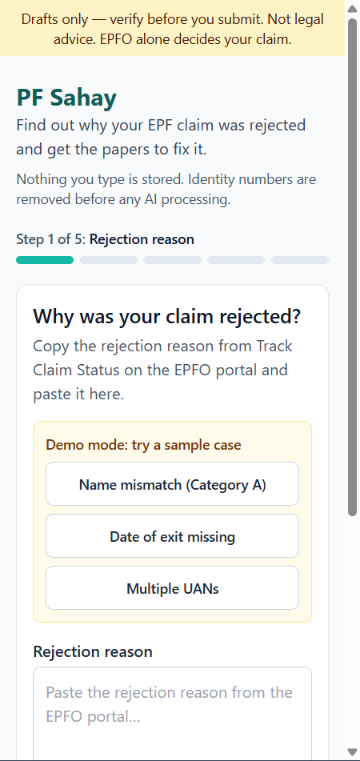
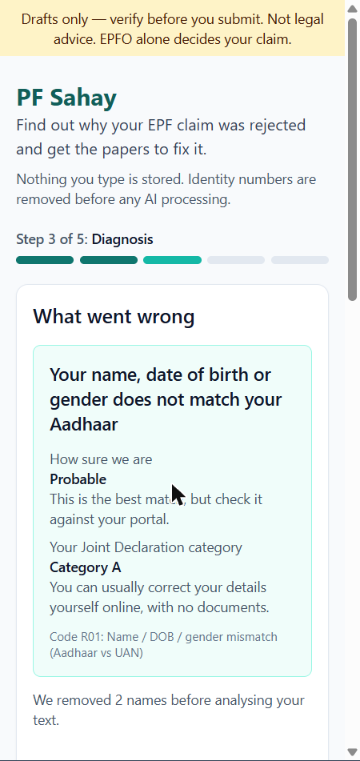
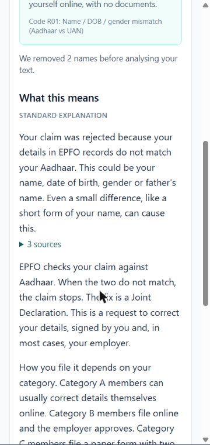
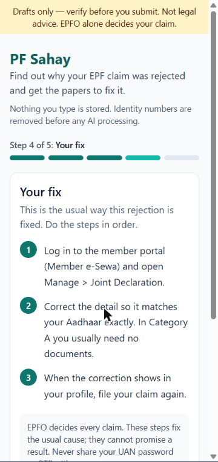
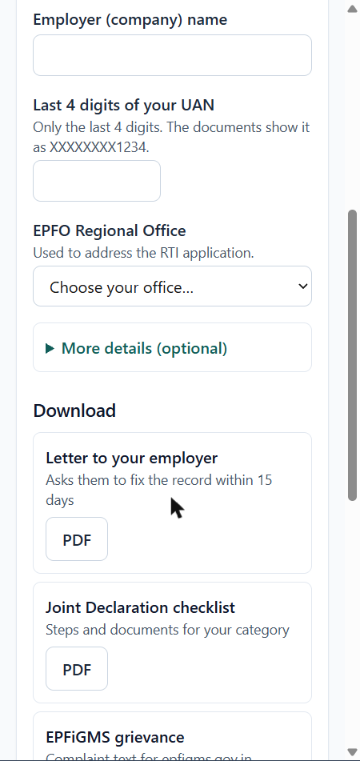

# PF Sahay

PF Sahay helps a worker whose EPF (Employees' Provident Fund) claim was rejected. Paste the rejection reason from the EPFO portal, answer five quick questions, and PF Sahay tells you in plain language what went wrong, how it is usually fixed, and hands you ready-to-send drafts: a letter to your employer, an EPFiGMS grievance, an RTI application and a Joint Declaration checklist.

Built for Indiathon 2026 (E-Cell IIIT Bhubaneswar × LearnApart), "Build Your MVP – 14 Day Challenge".

| 1. Paste the reason | 2. Diagnosis | 3. Explanation with sources | 4. Your fix | 5. Documents |
| --- | --- | --- | --- | --- |
|  |  |  |  |  |

*Screenshots at 360 px phone width.*

## How it works

1. **Capture** — paste the rejection text, or upload a screenshot (Tesseract OCR, read in memory).
2. **Strip personal data** — Aadhaar, PAN, UAN, bank account, mobile, email and names are removed before anything is logged or sent to an AI model.
3. **Classify** — a deterministic rules engine (no AI) maps the remark and your answers to one of 10 root causes (R01–R10) or asks one clarifying question (R00), and works out your Joint Declaration category (A/B/C).
4. **Explain** — one call to Claude explains the diagnosis at about a 6th-grade reading level, citing only the EPFO circular extracts it was given. Any sentence citing anything else is dropped; if too many are dropped, or the API is unavailable, a pre-written explanation is shown instead.
5. **Generate documents** — Jinja2 templates rendered to PDF with ReportLab. Nothing in a document is written by AI. Every page says *"AI-generated draft — verify before submission. Not legal advice. Sources cited for verification."*

Details and a diagram: [docs/ARCHITECTURE.md](docs/ARCHITECTURE.md). What is (and isn't) stored: [docs/PRIVACY.md](docs/PRIVACY.md).

| Code | Root cause | Usual fix |
| --- | --- | --- |
| R01 | Name / DOB / gender mismatch with Aadhaar | Joint Declaration — self (A), employer (B), physical (C) |
| R02 | Date of exit missing or wrong | Self-mark after 2 months, else employer; grievance; RTI |
| R03 | Date of joining mismatch / service overlap | Previous employer corrects the date; re-file |
| R04 | Bank KYC not verified | Re-upload bank details; employer approves |
| R05 | Aadhaar not seeded / wrong Aadhaar | Seed on portal; employer corrects via Joint Declaration |
| R06 | Multiple UANs / incomplete service | Form 13 transfer; de-link wrong member IDs |
| R07 | Previous claim pending | Wait, or ask for closure via grievance |
| R08 | Not eligible yet / wrong form | Two-month wait; correct form 19/10C/10D/31 |
| R09 | Tax documents (PAN, Form 121) | Verify PAN; submit Form 121 |
| R10 | Pension (EPS) problem | Employer rectifies EPS; correct pension form |

## Run locally

You need **Python 3.11+** and **Node.js 18+**.

1. Copy the example settings and add your Anthropic key (optional — without it the app uses its pre-written explanations):
   ```bash
   cp .env.example .env        # then edit .env and fill in ANTHROPIC_KEY
   ```
2. Install the backend (one time; the first run also downloads a ~90 MB embedding model):
   ```bash
   python -m venv .venv
   # Windows:        .venv\Scripts\pip install -r backend/requirements.txt
   # macOS / Linux:  .venv/bin/pip install -r backend/requirements.txt
   ```
3. Install the frontend (one time):
   ```bash
   cd frontend && npm install && cd ..
   ```
4. Start both servers:
   - macOS / Linux / WSL: `make dev`
   - Windows (Git Bash): `bash scripts/dev.sh`
   - Windows (PowerShell): `powershell -ExecutionPolicy Bypass -File scripts\dev.ps1`
5. Open http://localhost:3000. The API runs on http://127.0.0.1:8000 (`/health` should say `ok`).

The backend does not auto-reload: restart the script after changing Python code.

**Demo mode:** open http://localhost:3000/?demo=1 for three one-click sample cases (name mismatch, missing date of exit, multiple UANs). Demo mode always uses the pre-written explanations, so it works without an API key or internet.

**Screenshot upload** needs [Tesseract OCR](https://github.com/tesseract-ocr/tesseract) installed and on your PATH. Without it the button reads "OCR unavailable on this machine"; pasting text still works.

### Useful commands

| Command (macOS/Linux; on Windows run the script with `.venv\Scripts\python`) | What it does |
| --- | --- |
| `make test` | backend test suite (pytest) |
| `make corpus` | rebuild `backend/corpus/chunks.json` + `embeddings.npy` from `datasets/` |
| `make circulars` | try to download the EPFO circular PDFs listed in the dataset |
| `python scripts/try_explain.py` | three live explanations from the Claude API (a few cents) |
| `python scripts/eval_explain.py` | live citation check over all 45 test cases (about $0.30) |
| `python scripts/try_documents.py` | write four sample PDFs to `/tmp/pfsahay_samples/` (`%TEMP%` on Windows) |

## Results

See [docs/METRICS.md](docs/METRICS.md). In short: the classifier matches 45/45 labelled seed remarks and 20/20 paraphrases (55 % on the paraphrases before the rules were broadened — a fairer sign of how it will do on unseen wording); every citation returned by the explanation step resolves to a real corpus chunk; the diagnosis appears in milliseconds, the live AI explanation in about 6–8 seconds.

## Deploying

- **Backend:** `backend/Dockerfile` (build context = repo root) and `render.yaml` (Render blueprint). Set `ANTHROPIC_KEY` and `PFSAHAY_CORS_ORIGINS` in the host's dashboard. The service needs about 1 GB of RAM for the embedding model.
- **Frontend:** Vercel, project root `frontend/`, environment variable `NEXT_PUBLIC_API_URL` = the backend URL. No `vercel.json` is needed.

The Dockerfile has not been built yet (Docker was not running on the build machine).

## Datasets

Everything the classifier, corpus and templates rely on is in [`datasets/`](datasets/DATASETS.md): the 10-code taxonomy and 45 labelled remarks, Joint Declaration categories, approval matrix and document lists (from EPFO's 16 Jan 2025 circular and 13 Aug 2025 order), 152 member-services circulars with OCR of their first pages, 108 EPFO offices, and claim statistics. The corpus (72 chunks) is built from these plus 8 hand-written chunks with public sources.

## Limitations

- **The test set is small and hand-made.** 45 seed remarks and 20 paraphrases; real redacted screenshots are needed for a trustworthy accuracy figure.
- **EPFO's circular PDFs could not be downloaded** — every link now redirects to a page that returns 404. The corpus uses OCR of first pages (noisy) and four PDFs, so some answers cite a summary rather than the full circular. R09 (tax) has only two supporting chunks.
- **No postal addresses for EPFO offices**, so the RTI application prints a placeholder for the office address.
- **The live explanation takes 6–8 s**; the diagnosis, fix steps and documents do not wait for it.
- **English only.** Templates and explanations are in English; PDFs cannot render Indian scripts yet.
- **Name masking is best-effort** — a name without a cue word ("Ramesh says…") is not caught. Identity numbers always are.
- **OCR needs Tesseract**, and there is deliberately no AI fallback for screenshots (it would send an unredacted image to a third party).
- Rules and dates come from the circulars in the dataset as of November 2026; EPFO changes its procedures often.

## Disclaimer

PF Sahay produces drafts for you to verify before you submit them. It is not legal advice and it cannot promise that a claim will be approved — EPFO alone decides. It never asks for your UAN password or OTP, never logs in to the EPFO portal, and does not store Aadhaar, PAN, UAN or bank numbers.
