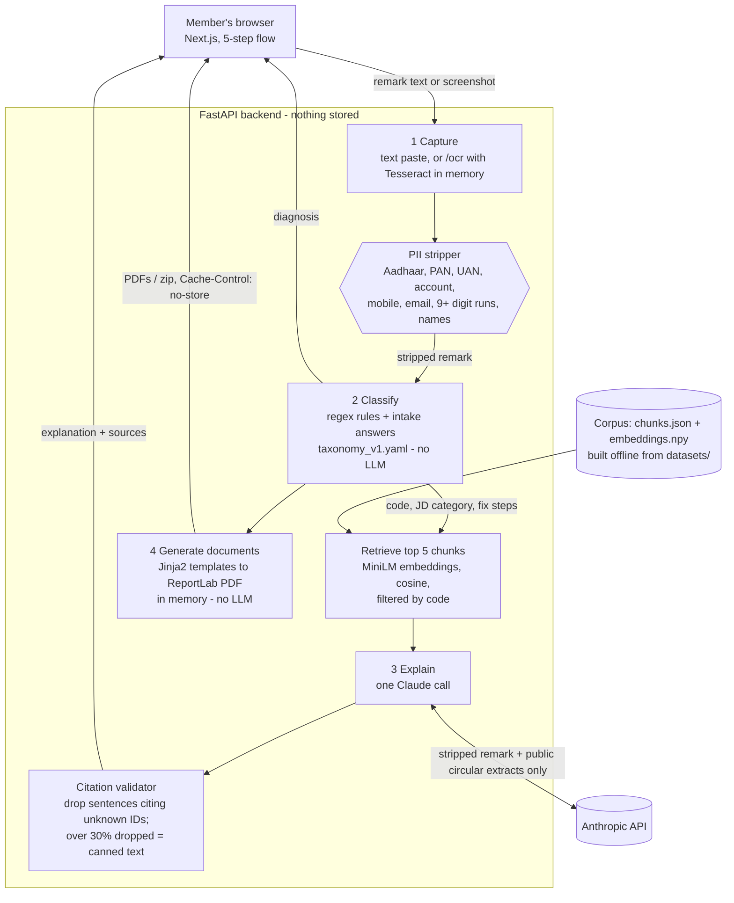

# Architecture

PF Sahay is a Next.js single-page frontend over a FastAPI backend. Four stages run on every check; only one of them calls an LLM, and every path into it passes through the PII stripper first.

## Where PII is removed

| Path | What is stripped | Where |
| --- | --- | --- |
| `/classify`, `/explain` | identity numbers **and** names | `pii.strip()` is the first line of each endpoint, before classification, logging or the LLM call |
| `/ocr` | identity numbers (names kept so the user can check the text) | text is stripped before it is returned; it is stripped again with names on `/classify` |
| `/documents`, `/documents/text` | identity numbers (names kept: the documents go back to the member only) | remark stripped; user-typed fields go only into the PDF; UAN accepted as last 4 digits only |
| Logs | nothing personal is ever logged | only `code`, `confidence`, model name and counts |

## Modules

| File | Role |
| --- | --- |
| `backend/app/pii.py` | regex PII stripper (numbers, emails, names after cue words) |
| `backend/app/intake.py` | the five intake answers and Joint Declaration category A/B/C |
| `backend/app/classifier.py` + `rules/*.yaml` | deterministic classifier, clarifying questions, plain-language fix steps |
| `backend/app/retrieval.py` | code-filtered cosine retrieval over the corpus |
| `backend/app/explain.py` + `prompts/` | the single Claude call, citation validator, canned fallbacks |
| `backend/app/documents.py` + `templates/` | Jinja2 templates rendered to PDF with ReportLab |
| `backend/app/ocr.py` | Tesseract OCR, in memory |
| `backend/corpus/build_corpus.py` | offline corpus build (`make corpus`) |
| `frontend/app/page.tsx`, `frontend/components/` | the five-step UI |

## Calls to third parties

| Service | When | What it receives |
| --- | --- | --- |
| Anthropic API (`claude-sonnet-5-5`) | once per explanation, not in demo mode, not without a key | PII-stripped remark, diagnosis code, intake answers (form, category), up to 5 public corpus extracts |
| Hugging Face Hub | first run only, to download the embedding model | nothing about the user |

No other network calls are made at runtime.
